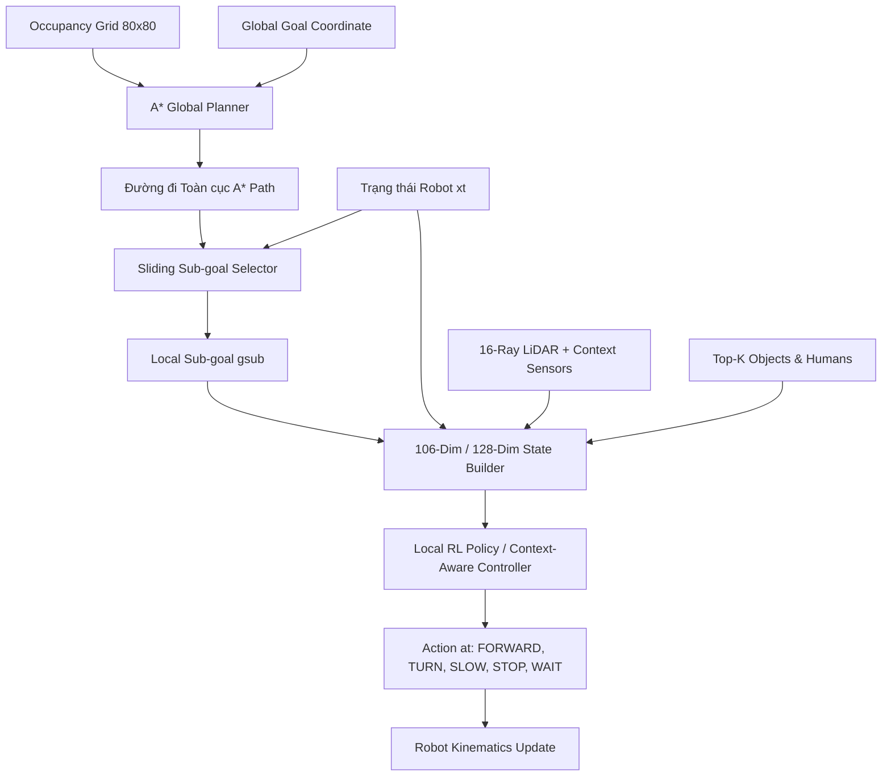
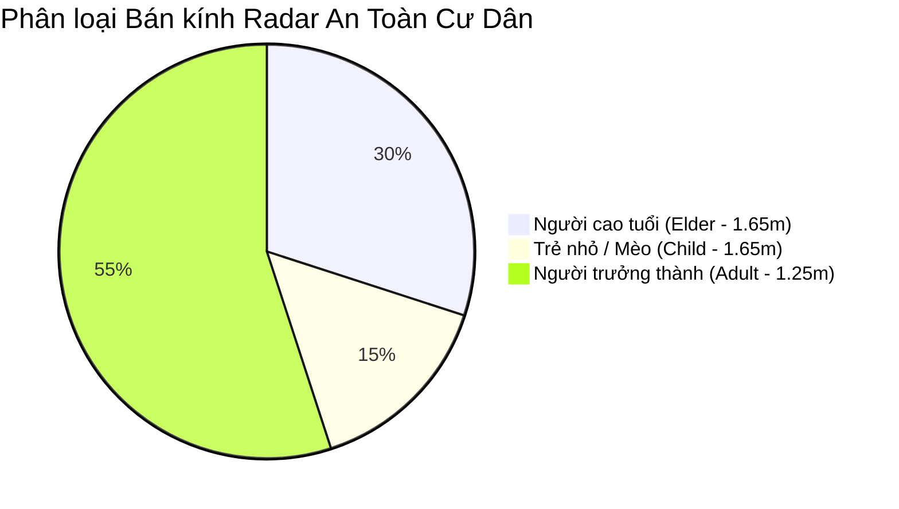
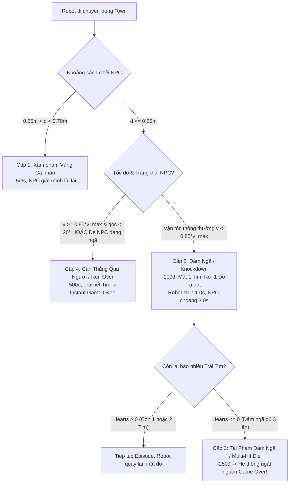
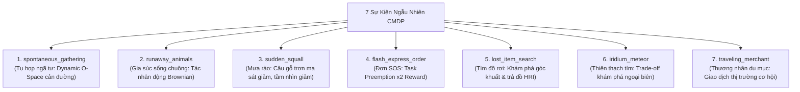
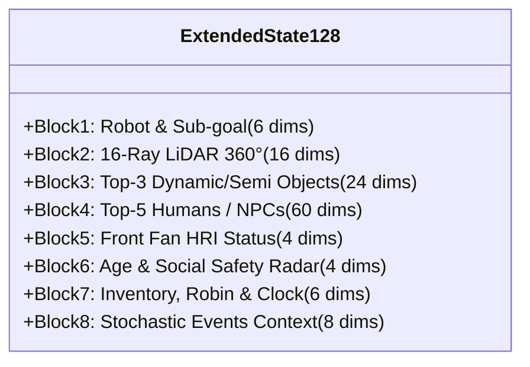
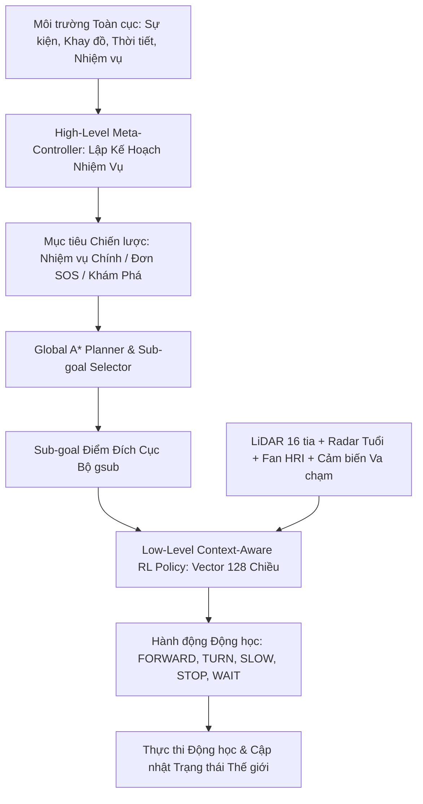

# Context-Aware Robot Navigation Simulation
**(Tài liệu Đặc tả Kỹ thuật & Hướng dẫn Triển khai Hệ thống Toàn diện)**

---

## 1. Tổng quan Dự án
* **Tên đề tài (Tiếng Anh):** Context-Aware Robot Navigation Simulation & FarmBot Town Benchmark
* **Tên đề tài (Tiếng Việt):** Mô phỏng điều hướng robot tự hành nhận thức ngữ cảnh vật lý, xã hội và tương tác người-máy (HRI)
* **Mục tiêu cốt lõi:** Xây dựng môi trường mô phỏng 2D lai (Hybrid Grid + Continuous Physics) để nghiên cứu, huấn luyện và đánh giá các thuật toán điều hướng Robot tự hành (A*, Rule-based Social Navigation, Deep Reinforcement Learning - DQN/PPO/SAC) có khả năng nhận thức sâu sắc trạng thái vật lý của vật thể, không gian cá nhân của con người, văn hóa tương tác xã hội (HRI) và thích ứng với các biến cố môi trường ngẫu nhiên bất định.
* **Từ khóa:** Robot Navigation, Context-Aware Navigation, Human-Aware Navigation, Social Navigation, Reinforcement Learning, Contextual MDP, Non-Stationary Environments, Human-Robot Interaction (HRI), 2D Simulation, Safe RL, Multi-Map RPG.

---

## 2. Thiết kế Không gian Mô phỏng & Động học (Hybrid World & Kinematics)

### 2.1. Không gian Lai (Occupancy Grid + Continuous 2D Space)
* **Kích thước bản đồ thực:** $W \times H = 20.0\text{ m} \times 20.0\text{ m}$.
* **Bước thời gian mô phỏng cố định:** $\Delta t = 0.1\text{ s}$ (tần số cập nhật $10\text{ Hz}$), số bước tối đa mỗi Episode $T_{\text{max}} = 600$ bước ($60\text{ s}$).
* **Bản đồ lưới nền (Occupancy Grid):** Độ phân giải $\Delta g = 0.25\text{ m}$, tạo thành lưới $80 \times 80$ ô phục vụ thuật toán tìm đường toàn cục A*.
* **Tỉ lệ hiển thị đồ họa:** $1.0\text{ m} = 48.0\text{ pixels}$. Màn hình hiển thị độ phân giải $1152 \times 768$ (tương ứng với lưới $36 \times 24$ ô gạch kích thước $32 \times 32\text{ px}$).

### 2.2. Trạng thái và Động học của Robot
Robot được mô hình hóa là hình tròn bán kính $R_{\text{robot}} = 0.35\text{ m}$ với vector trạng thái động học vi sai tại thời điểm $t$:
$$\mathbf{x}_t = [x_t, y_t, \theta_t, v_t, \omega_t]^T$$

Trong đó:
* $(x_t, y_t) \in \mathbb{R}^2$ là tọa độ tâm của Robot trên mặt phẳng tọa độ thế giới thực.
* $\theta_t \in [-\pi, \pi]$ là góc hướng mũi của Robot (Orientation Angle).
* $v_t \in [0, v_{\text{max}}]$ là vận tốc dài tức thời ($v_{\text{max}} = 1.0\text{ m/s}$).
* $\omega_t \in [-\omega_{\text{max}}, \omega_{\text{max}}]$ là vận tốc góc tức thời ($\omega_{\text{max}} = \frac{\pi}{3}\text{ rad/s} \approx 1.047\text{ rad/s}$).

Phương trình cập nhật trạng thái động học vi sai (Unicycle Kinematic Model) mỗi bước thời gian $\Delta t$:
$$x_{t+1} = x_t + v_t \cos(\theta_t) \Delta t$$
$$y_{t+1} = y_t + v_t \sin(\theta_t) \Delta t$$
$$\theta_{t+1} = \text{atan2}(\sin(\theta_t + \omega_t \Delta t), \cos(\theta_t + \omega_t \Delta t))$$

### 2.3. Không gian Hành động Rời rạc (Discrete Action Space)
Hệ thống điều khiển cục bộ của Robot hoạt động trên không gian hành động rời rạc gồm 6 thao tác cơ bản:

| Mã lệnh ($a_t$) | Tên hành động | Vận tốc dài ($v$) | Vận tốc góc ($\omega$) | Ý nghĩa điều hướng & Ngữ cảnh áp dụng |
| :---: | :--- | :---: | :---: | :--- |
| `0` | `FORWARD` | $1.0\text{ m/s}$ | $0.0\text{ rad/s}$ | Tiến thẳng tối đa khi đường thông thoáng và an toàn |
| `1` | `TURN_LEFT` | $0.5\text{ m/s}$ | $+\frac{\pi}{3}\text{ rad/s}$ | Vừa tiến vừa cua trái né tránh chướng ngại vật |
| `2` | `TURN_RIGHT` | $0.5\text{ m/s}$ | $-\frac{\pi}{3}\text{ rad/s}$ | Vừa tiến vừa cua phải né tránh chướng ngại vật |
| `3` | `SLOW_DOWN` | $0.3\text{ m/s}$ | $0.0\text{ rad/s}$ | Giảm tốc khi qua lối hẹp, đông người hoặc mặt đường trơn |
| `4` | `STOP` | $0.0\text{ m/s}$ | $0.0\text{ rad/s}$ | Phanh dừng khẩn cấp trước nguy cơ va chạm trực diện |
| `5` | `WAIT` | $0.0\text{ m/s}$ | $0.0\text{ rad/s}$ | Đứng chờ lịch sự (nhường người cắt ngang hoặc chờ cửa mở) |

---

## 3. Phân loại Hệ thống Đối tượng trong Môi trường

1. **Vật thể Tĩnh (`StaticObject`):**
   * Bao gồm tường bao, vách ngăn phòng, quầy kệ, bàn ghế, cột trụ đá, gốc cây cổ thụ.
   * Hình học: Hình chữ nhật trục song song `RECTANGLE` $(x_{\min}, y_{\min}, w, h)$ hoặc Hình tròn `CIRCLE` $(x, y, r)$.
   * Không thể xuyên thấu; phản xạ hoàn toàn các tia quét cảm biến LiDAR.

2. **Vật thể Bán tĩnh (`SemiStaticObject`):**
   * Bao gồm cửa tự động (Automatic Sliding Door), thanh chắn an toàn (Barrier), cổng rào nông trại.
   * Cơ chế chuyển pha hoạt động theo máy trạng thái hữu hạn (**FSM - Finite State Machine**):
     $$\text{CLOSED} \xrightarrow{t_{\text{close}}} \text{OPENING} \xrightarrow{t_{\text{trans}}} \text{OPEN} \xrightarrow{t_{\text{open}}} \text{CLOSING} \xrightarrow{t_{\text{trans}}} \text{CLOSED}$$
   * Thuộc tính `passable`: Chỉ bằng `True` khi trạng thái là `OPEN`. Biến `time_to_next_state` đếm ngược thời gian chuyển sang trạng thái kế tiếp, cung cấp thông tin dự báo ngữ cảnh cho Agent.

3. **Vật thể Động (`DynamicObject`):**
   * Xe đẩy tự hành trong nhà kho (AGV), xe kéo hàng tuần tra theo lộ trình xác định với vector vận tốc $(v_x, v_y)$.
   * Tích hợp bộ dự báo quỹ đạo ngắn hạn nội suy tuyến tính trong khoảng nhìn trước $T_{\text{pred}} \in [1.0\text{ s}, 3.0\text{ s}]$.

4. **Con người & Cư dân (`HumanAgent` & `HumanGroup`):**
   * Bán kính chiếm dụng cơ thể vật lý $r_{\text{human}} = 0.30\text{ m}$.
   * **Trạng thái hoạt động thể chất (Activity State):**
     * `STANDING`: Đang đứng yên quan sát hoặc làm việc.
     * `WALKING`: Di chuyển tuần tra hoặc đi dạo với vận tốc $v \in [0.4, 0.8]\text{ m/s}$.
     * `RUNNING`: Chạy nhanh thể dục hoặc vội vã với vận tốc $v \in [1.0, 1.4]\text{ m/s}$.
   * **Ngữ cảnh xã hội đối kháng (Social Context):**
     * `ALONE`: Di chuyển hoặc đứng độc lập, không chịu ảnh hưởng từ nhóm.
     * `APPROACHING`: Đang bước trực diện về phía mũi Robot.
     * `CROSSING`: Đang bước cắt ngang vuông góc quỹ đạo phía trước Robot.
     * `INTERACTING`: Đang đứng tụ tập trò chuyện theo nhóm $2\text{--}4$ người.

---

## 4. Mô hình Không gian Xã hội (Social Space & O-Space Modeling)

### 4.1. Hàm Gaussian Bất đối xứng cho Cá nhân (Asymmetric Personal Space)
Không gian cá nhân quanh mỗi con người thứ $i$ tại tọa độ $(x_h, y_h)$, góc hướng mặt $\theta_h$ và tốc độ di chuyển $v_h$ được mô hình hóa bằng hàm phân bố Gaussian hai chiều bất đối xứng, phản ánh tâm lý học không gian (Proxemics) - con người nhạy cảm hơn với các vật thể tiếp cận từ phía trước hướng di chuyển:

$$\sigma_{\text{front}} = \sigma_0 + \alpha v_h, \quad \sigma_{\text{back}} = \sigma_0, \quad \sigma_{\text{side}} = 0.8 \sigma_0$$

Với độ lệch chuẩn cơ sở $\sigma_0 = 0.65\text{ m}$ và hệ số tốc độ $\alpha = 0.6\text{ s}$.
Chuyển vị trí Robot $(x_r, y_r)$ sang hệ tọa độ cục bộ gắn với con người:
$$\begin{bmatrix} \Delta x' \\ \Delta y' \end{bmatrix} = \begin{bmatrix} \cos\theta_h & \sin\theta_h \\ -\sin\theta_h & \cos\theta_h \end{bmatrix} \begin{bmatrix} x_r - x_h \\ y_r - y_h \end{bmatrix}$$

Hàm chi phí vi phạm không gian xã hội cá nhân $C_{\text{social}}(x_r, y_r)$ được xác định:
$$C_{\text{social}}(x_r, y_r) = \exp\left( -\left( \frac{(\Delta x')^2}{2\sigma_{x}^2} + \frac{(\Delta y')^2}{2\sigma_{\text{side}}^2} \right) \right)$$
Trong đó:
$$\sigma_x = \begin{cases} \sigma_{\text{front}}, & \text{nếu } \Delta x' \ge 0 \text{ (Robot ở nửa mặt phía trước)} \\ \sigma_{\text{back}}, & \text{nếu } \Delta x' < 0 \text{ (Robot ở nửa mặt phía sau)} \end{cases}$$

### 4.2. Không gian Tương tác Nhóm (Group O-Space)
Khi một tập hợp $K \ge 2$ người ở trạng thái `INTERACTING`, họ hình thành một cụm xã hội hướng mặt vào tâm chung $\mathbf{c}_{\text{group}} = (\bar{x}_h, \bar{y}_h) = \frac{1}{K}\sum_{i=1}^K (x_i, y_i)$.
* Vùng không gian rỗng ở giữa họ được gọi là **O-Space** (Orientation Space) có bán kính bao phủ:
  $$R_{\text{group}} = \max_{i=1..K} \|\mathbf{x}_i - \mathbf{c}_{\text{group}}\|_2 + \sigma_0$$
* Quy tắc xã hội nghiêm cấm người hoặc phương tiện lạ cắt ngang qua tâm đàm thoại của nhóm. Robot bị áp đặt hình phạt nặng (`Group Splitting Penalty`) nếu khoảng cách từ tâm Robot tới tâm cụm vi phạm điều kiện an toàn:
  $$d(\mathbf{x}_{\text{robot}}, \mathbf{c}_{\text{group}}) < R_{\text{group}} + R_{\text{robot}}$$

---

## 5. Kiến trúc Điều hướng Phân tầng (A* Global Planner + Local Sub-goal + RL)

Hệ thống điều hướng sử dụng kiến trúc phân tầng kết hợp giữa lập kế hoạch hình học toàn cục và chính sách học tăng cường thích ứng cục bộ:



1. **Global Path Planning (A*):** Tìm đường đi ngắn nhất trên lưới Occupancy Grid $80 \times 80$. Ma trận chi phí có thể tích hợp lớp Social Costmap để chủ động hướng đường đi tránh các cụm nhóm tĩnh.
2. **Local Sub-goal Selector:** Trích xuất một điểm mục tiêu cục bộ $\mathbf{g}_{\text{sub}} = (x_{\text{sub}}, y_{\text{sub}})$ trượt dọc theo đường đi A*, cách vị trí Robot một khoảng nhìn trước cố định $L_{\text{lookahead}} = 2.5\text{ m}$.
3. **Local RL Policy:** Đóng vai trò bộ điều khiển phản xạ thời gian thực ($\Delta t = 0.1\text{ s}$), tiếp nhận vector trạng thái chuẩn hóa và sinh hành động né tránh chướng ngại vật động, thích ứng với quy chuẩn xã hội.

---

## 6. Thiết kế Môi trường Reinforcement Learning (Gymnasium 128-Dim Unified FarmBot Town)

### 6.1. Vector Trạng thái 128 Chiều Thống nhất ($\mathbf{S}_t^{\text{ext}} \in \mathbb{R}^{128}$)
Toàn bộ tọa độ và vận tốc đều được chuyển về **Hệ quy chiếu gắn với Robot (Robot-Centric Frame)** nhằm đảm bảo tính bất biến tịnh tiến và quay, tích hợp trực tiếp cả cảm biến vật lý lẫn ngữ cảnh xã hội – nông trại – sự kiện của **FarmBot Town**:

* **Khối 1 – Trạng thái Robot & Sub-goal ($6$ chiều):**
  $$\left[ \frac{d_{\text{sub}}}{D_{\text{max}}}, \sin(\Delta\theta_{\text{sub}}), \cos(\Delta\theta_{\text{sub}}), \frac{d_{\text{goal}}}{D_{\text{max}}}, \frac{v_t}{v_{\text{max}}}, \frac{\omega_t}{\omega_{\text{max}}} \right]$$
  Trong đó $\Delta\theta_{\text{sub}} = \text{atan2}(y_{\text{sub}} - y_r, x_{\text{sub}} - x_r) - \theta_r$ là góc lệch hướng tới Sub-goal.
* **Khối 2 – Cảm biến LiDAR 360° ($16$ chiều):**
  Khoảng cách chuẩn hóa từ 16 tia Raycast cách đều $22.5^\circ$ trong bán kính quan sát $R_{\text{sensor}} = 6.0\text{ m}$:
  $$s_{\text{lidar}, i} = \frac{\min(\text{ray\_hit}_i, R_{\text{sensor}})}{R_{\text{sensor}}} \in [0, 1], \quad i = 1..16$$
* **Khối 3 – Top-$K$ Vật thể Bán tĩnh / Động gần nhất ($K = 3 \times 8 = 24$ chiều):**
  Bao gồm Xe kéo nông sản `FarmCartAGV`, Thú nuôi `FarmAnimal` và Cổng rào bán tĩnh FSM:
  $$[x_{\text{rel}}, y_{\text{rel}}, v_{x,\text{rel}}, v_{y,\text{rel}}, r_{\text{obj}}, \text{is\_semi}, \text{is\_dyn}, \text{passable}]$$
* **Khối 4 – Top-$M$ Con người / NPC Cư dân gần nhất ($M = 5 \times 12 = 60$ chiều):**
  Đồng bộ trực tiếp từ lộ trình tuần tra của `VillagerNPC` và lịch trình theo giờ `game/schedules.py`:
  $$[x_{\text{rel}}, y_{\text{rel}}, v_{x,\text{rel}}, v_{y,\text{rel}}, \sin(\theta_{\text{rel}}), \cos(\theta_{\text{rel}}), \text{one\_hot}_{\text{activity}}(3), \text{one\_hot}_{\text{context}}(3)]$$
* **Khối 5 – Trạng thái Vùng Quạt Tương tác HRI với NPC Mục tiêu / Gần nhất ($4$ chiều):**
  $$[d_{\text{npc}}/5.0, \Delta\alpha_{\text{npc}}/\pi, \Delta\alpha_{\text{robot}}/\pi, \text{in\_fan\_ok}]$$
* **Khối 6 – Nhóm Tuổi & Bán kính Radar An toàn của NPC Gần nhất ($4$ chiều):**
  $$[\text{is\_adult}, \text{is\_elder}, \text{is\_child}, R_{\text{safe}}/2.0]$$
* **Khối 7 – Trạng thái Khay đồ, Đồng hồ Ngày-Đêm, Thời tiết Mưa/Đêm, Mùa & Trái Tim An Toàn ($6$ chiều):**
  $$[\text{inv\_ratio}, \text{has\_quest\_item}, \text{clock\_norm}, \text{is\_rain\_or\_night}, \text{season\_idx\_norm}, \text{safety\_hearts\_norm}]$$
* **Khối 8 – Vector Sự kiện Ngẫu nhiên Động CMDP từ `game/random_events.py` ($8$ chiều):**
  $$[\text{event\_active}, \text{event\_type\_id\_norm}, \Delta x_{\text{event}}/20.0, \Delta y_{\text{event}}/20.0, d_{\text{event}}/20.0, \text{event\_time\_left\_norm}, \text{event\_reward\_norm}, \text{is\_ospace\_hazard}]$$

### 6.2. Hàm Phần thưởng Đa mục tiêu Mở rộng (Multi-Objective FarmBot Town Reward)
$$R_t^{\text{ext}} = R_{\text{goal}} + R_{\text{collision}} + R_{\text{progress}} + R_{\text{time}} + R_{\text{social}} + R_{\text{group}} + R_{\text{context}} + R_{\text{fan}} + R_{\text{elder\_safe}} + R_{\text{event}}$$

* **Phần thưởng Đích ($R_{\text{goal}}$):** $+100.0$ khi Robot chạm vòng đích ($d < R_{\text{robot}} + R_{\text{goal}}$).
* **Hình phạt Va chạm ($R_{\text{collision}}$):** $-100.0$ khi xảy ra va chạm vật lý (hoặc $-150.0$ nếu cán tốc độ cao làm mất hết Trái Tim An Toàn).
* **Thưởng Tiến triển & Bám hướng Sub-goal ($R_{\text{progress}}$):** $3.5 \cdot (0.65 \Delta d_{\text{sub}} + 0.35 \Delta d_{\text{goal}}) + R_{\text{heading}}$ khuyến khích Robot bám sát lộ trình A* tới đích.
* **Chi phí Thời gian & Chống Đứng Yên Vô Cớ ($R_{\text{time}}$):** $-0.05$ mỗi bước $\Delta t$ (kèm phạt $-0.08$ nếu đứng im $v < 0.02\text{ m/s}$ khi không có tình huống cần nhường đường).
* **Phạt Vi phạm Vùng Cá nhân ($R_{\text{social}}$) & Phạt Cắt ngang Nhóm O-Space ($R_{\text{group}}$):** Phạt trơn theo hàm Gaussian cá nhân và phạt $-5.0$ khi đi xuyên qua tâm nhóm đang trò chuyện.
* **Thưởng Nhận thức Ngữ cảnh, Vùng Quạt HRI & Radar Độ Tuổi ($R_{\text{context}} + R_{\text{fan}} + R_{\text{elder\_safe}} + R_{\text{event}}$):** Thưởng khi chủ động giảm tốc/chờ đợi trước người `CROSSING`, đi chậm trong vùng Radar $1.65\text{ m}$ của người già (`elder`) / trẻ nhỏ (`child`), tiếp cận từ phía trước mặt NPC và vòng tránh vùng sự kiện `is_ospace_hazard`.

---

## 7. Danh mục 15 Topology Bản đồ (4 Bản đồ Game FarmBot Town + 11 Kịch bản Xã hội)

### 7.1. Phân chia 15 Topology (`Game` / `Train` / `Validation` / `Unseen Test`)
Hệ thống kết hợp trực tiếp **4 Bản đồ Ngoài trời của FarmBot Town (`Topologies 1–4`, chạy `HeadlessGameSession` đồng bộ thực thể từ `game/`)** với **11 Kịch bản Xã hội Chuẩn hóa (`Topologies 5–15`)**:

* **Tập Bản đồ Game Chính thức (`GAME_TOPOLOGIES = [1, 2, 3, 4]`, thuộc `TRAIN_TOPOLOGIES 1–9`):**
  1. `Game Map 1: Pelican Town Square & 2 Bridges` (Quảng trường Thị trấn, dòng sông phía Đông với Cầu Đá & Cầu Gỗ, 4 tòa nhà lớn và 6 NPC tuần tra theo lịch trình `game/schedules.py`).
  2. `Game Map 2: Orchard Farm & 6 Crop Fields` (Đại Nông Trại, 6 thửa ruộng có hàng rào, vườn cây ăn quả, chuồng gia súc, xe kéo `FarmCartAGV` và 5 nông dân).
  3. `Game Map 3: Lakeside Island & 3 Docks` (Đảo Rừng Xanh, hồ nước lớn chia cắt với 3 cây cầu gỗ hẹp và 4 điểm câu cá).
  4. `Game Map 4: Residential Village & Robot Workshop` (Khu Dân Cư 4 dinh thự + Xưởng Robot Số 5 và các tuyến đi bộ của cư dân).

* **Tập Kịch bản Giao thông & Xã hội Bổ trợ (`Topologies 5 – 9`, thuộc `TRAIN_TOPOLOGIES`):**
  5. `T-Junction` (Ngã ba có các luồng người cắt ngang từ hai hướng).
  6. `Cross Intersection` (Ngã tư đông đúc có các luồng giao thông đan xen).
  7. `Single Door Room` (Phòng có một cửa tự động FSM đóng/mở chu kỳ).
  8. `Two-Room Connected` (Hai phòng nối nhau qua hành lang trung gian).
  9. `Pillar Hall` (Đại sảnh có hệ thống các cột trụ tròn phân bố đều).

* **Tập Kiểm định (`VAL_TOPOLOGIES = [10, 11, 12]`):**
  10. `Double Bottleneck` (Hai nút thắt cổ chai liên tiếp).
  11. `Three-Room Office` (Không gian văn phòng 3 phòng liên thông có cửa tự động).
  12. `Courtyard Dynamic Lanes` (Sân trong với các làn xe đẩy AGV di chuyển liên tục).

* **Tập Kiểm thử Chưa Từng Gặp (`TEST_TOPOLOGIES = [13, 14, 15]`):**
  13. `H-Shaped Complex` (Tổ hợp chữ H kết hợp hai hành lang và nút thắt).
  14. `Multi-Room Maze` (Mê cung nhiều phòng thử thách lập kế hoạch đường dài).
  15. `Crowded Plaza & Gates` (Quảng trường đông đúc tích hợp nhiều nhóm đàm thoại O-Space và cổng barrier).

### 7.2. Bốn Phương pháp Đánh giá So sánh (4 Baselines)
1. **Baseline 1 (`A* + Basic Collision Avoidance`):** Lập kế hoạch đường A* trên bản đồ tĩnh, phanh dừng khi vật cản xuất hiện trong bán kính an toàn, hoàn toàn không nhận thức ngữ cảnh xã hội.
2. **Baseline 2 (`A* + Social Rules`):** Kết hợp A* với Social Costmap mở rộng và hệ thống luật cứng nhường đường khi phát hiện người `CROSSING` hoặc cửa đóng.
3. **Baseline 3 (`RL No-Context`):** Huấn luyện mô hình PPO/DQN với vector 128 chiều nhưng ẩn toàn bộ thông tin ngữ cảnh xã hội, độ tuổi, vùng quạt HRI và sự kiện (`include_social_context=False`).
4. **Baseline 4 (`Context-Aware RL - Proposed`):** Huấn luyện PPO/DQN (khởi động ấm bằng Behavioral Cloning từ chuyên gia + tinh chỉnh RL đa luồng) với đầy đủ vector trạng thái $128$ chiều và hàm thưởng ngữ cảnh mở rộng của FarmBot Town.

---

## 8. Kiến trúc Thư mục Dự án Chuẩn (Đã Tinh Gọn & Tối Ưu Hóa Cho Game + Kaggle)

Cấu trúc mã nguồn thống nhất giữa trò chơi **FarmBot Town (`game/`)** và hệ thống huấn luyện **Deep RL Headless (`rl/`, `environment/`, `kaggle_train.py`)**:

```text
simulation_aware_robot/
├── README.md                                    # Hướng dẫn khởi chạy Game & Huấn luyện RL trên Kaggle
├── requirements.txt                             # Danh mục thư viện phụ thuộc (Pygame-ce, Gymnasium, SB3)
├── Context-Aware-Robot-Navigation-Simulation.md # Tài liệu Đặc tả Kỹ thuật & RL 128-Dim Specification
├── Context_game_farmbot.md                      # Tài liệu Đặc tả Thiết kế FarmBot Town RPG
├── main.py                                      # Điểm khởi chạy chính (Mở Game hoặc kiểm tra --check-env)
├── kaggle_train.py                              # Pipeline đóng gói Dataset & Huấn luyện tự động trên Kaggle
│
├── configs/                                     # Cấu hình tham số hệ thống
│   ├── default_config.yaml                      # Tham số vật lý, bản đồ 20m, cảm biến LiDAR
│   └── rl_hyperparams.yaml                      # Siêu tham số huấn luyện DQN/PPO, trọng số Reward
│
├── environment/                                 # Môi trường mô phỏng 20m x 20m tích hợp HeadlessGameSession
│   ├── __init__.py
│   ├── world.py                                 # Quản lý vật lý, đồng bộ NPC/Schedules/AGV/Events từ game/
│   ├── topology.py                              # Định nghĩa 15 Topology (Maps 1-4 Game + Topologies 5-15)
│   ├── map_generator.py                         # Sinh bản đồ 4 Map Stardew Valley & 11 kịch bản xã hội
│   ├── spawn_manager.py                         # Phân bổ vị trí Robot, Goal, Vật thể & Con người (theo nhóm tuổi)
│   └── physics.py                               # Động học vi sai, kiểm tra va chạm, LiDAR Raycast 16 tia
│
├── objects/                                     # Thực thể vật thể trong môi trường
│   ├── __init__.py
│   ├── base_object.py                           # Lớp cơ sở trừu tượng (id, vị trí, bán kính, loại)
│   ├── static_object.py                         # Tường, sông hồ, nhà cửa, chướng ngại vật cố định
│   ├── semi_static_object.py                    # Cửa trượt tự động FSM, cổng rào nông trại
│   ├── dynamic_object.py                        # Xe đẩy AGV, thú nuôi chuyển động & dự đoán quỹ đạo
│   └── robot.py                                 # Lớp trạng thái và động học của Robot tự hành
│
├── human/                                       # Hệ thống mô hình hóa hành vi con người & độ tuổi
│   ├── __init__.py
│   ├── human_agent.py                           # Lớp con người (Physical, Activity, Social Context, Age Radar)
│   ├── motion_model.py                          # Chuyển động Waypoint + Lực đẩy xã hội (Social Force)
│   ├── groups.py                                # Quản lý nhóm di chuyển chung và nhóm đứng O-Space
│   └── social_space.py                          # Tính toán hàm phân bố Gaussian cá nhân bất đối xứng
│
├── perception/                                  # Tầng tri giác và cảm biến
│   ├── __init__.py
│   └── ground_truth.py                          # Trích xuất đối tượng trong tầm quan sát cảm biến
│
├── planning/                                    # Tầng lập kế hoạch đường đi
│   ├── __init__.py
│   ├── astar.py                                 # Tìm đường toàn cục A* kết hợp Social Costmap
│   └── subgoal_selector.py                      # Trích xuất Sub-goal trượt dọc lộ trình A*
│
├── behavior/                                    # Mô hình hóa hành vi & Baseline Agents
│   ├── __init__.py
│   ├── context_classifier.py                    # Bộ phân loại ALONE, APPROACHING, CROSSING, INTERACTING
│   └── rule_based_agent.py                      # Triển khai Baseline 1 (A* Basic) và Baseline 2 (Social Rules)
│
├── rl/                                          # Tầng Học tăng cường sâu (Deep Reinforcement Learning)
│   ├── __init__.py
│   ├── gym_env.py                               # Lớp môi trường chuẩn Gymnasium 128 chiều (Headless)
│   ├── state_builder.py                         # Bộ trích xuất Vector trạng thái mở rộng 128 chiều
│   ├── reward_calculator.py                     # Bộ tính toán hàm phần thưởng mở rộng FarmBot Town
│   └── train_eval.py                            # Huấn luyện đa luồng SubprocVecEnv + BC Warm-start (PPO/DQN)
│
├── evaluation/                                  # Tầng đánh giá hiệu năng & Benchmark
│   ├── __init__.py
│   ├── metrics.py                               # Đo đạc Navigation, Safety, Social, Generalization metrics
│   └── benchmark_runner.py                      # Tự động hóa đánh giá 4 Baselines trên tập Game / Val / Test
│
├── visualization/                               # Xuất biểu đồ báo cáo khoa học
│   ├── __init__.py
│   └── plot_results.py                          # Vẽ biểu đồ Learning Curve và biểu đồ đối sánh Benchmark
│
├── game/                                        # Trò chơi chính thức FarmBot Town & Headless Game Engine
│   ├── __init__.py
│   ├── __main__.py                              # Khởi chạy trực tiếp qua `python -m game`
│   ├── app.py                                   # Vòng lặp chính Pygame-ce & Điều phối hệ thống
│   ├── atmosphere.py                            # Chu kỳ Ngày/Đêm, Hệ thống Chiếu sáng & Thời tiết mưa tuyết
│   ├── audio.py                                 # Quản lý hiệu ứng âm thanh Procedural & Âm nhạc Chiptune
│   ├── autopilot.py                             # Bộ điều hướng tự động [P] tích hợp trực tiếp model RL
│   ├── constants.py                             # Hằng số vật lý, quy đổi Mét/Pixel, tham số vùng quạt HRI
│   ├── dialogue.py                              # Hệ thống hội thoại phân nhánh & Mức độ Thân thiện (Hearts)
│   ├── entities.py                              # Thực thể Robot, 12 Cư dân NPC, Xe kéo AGV & Động vật
│   ├── farming.py                               # Hệ thống canh tác nông trại mở rộng
│   ├── game_state.py                            # Quản lý túi đồ (Inventory), Rơi đồ Knockdown, Điểm số
│   ├── journal_ui.py                            # Giao diện Nhật ký nhiệm vụ, Bản đồ thị trấn & Danh bạ NPC
│   ├── maps.py                                  # Thiết kế 5 bản đồ liên thông & Điểm dịch chuyển (Warps)
│   ├── quests.py                                # Hệ thống nhiệm vụ cốt truyện, Giao hàng nhanh & Đơn SOS
│   ├── random_events.py                         # Quản lý 7 sự kiện ngẫu nhiên động (Non-stationary CMDP)
│   ├── rl_bridge.py                             # Cầu nối `HeadlessGameSession` & `GameRLNavigator` 128 chiều
│   ├── safety_hri.py                            # Hệ thống An toàn 4 Cấp độ & Vùng Quạt Xanh Lá HRI
│   ├── schedules.py                             # Lịch trình sinh hoạt thời gian thực 24h của 12 NPC
│   ├── sprite_vault.py                          # Bộ nạp Sprite Pixel-Art (hỗ trợ Headless Fallback Sizes)
│   ├── stardew_systems.py                       # Cơ chế Xới đất, Tưới nước, Trồng trọt & Mini-game Câu cá
│   ├── terrain.py                               # Hệ thống Auto-Tiling địa hình tự nhiên (47-tile bitmask)
│   ├── ui_renderer.py                           # Vẽ HUD thanh trạng thái, Đồng hồ, Radar & Khay đồ
│   ├── vfx.py                                   # Hệ thống hạt Visual FX (Lá rơi, Sóng nước, Bụi, Sao choáng)
│   ├── world_builder.py                         # Kiến tạo cảnh quan thế giới, Bố trí chướng ngại vật & Nhà cửa
│   ├── data/                                    # Cơ sở dữ liệu JSON của thị trấn
│   │   ├── items.json                           # Bảng danh mục nông sản, công cụ, phẩm chất Sao & giá
│   │   ├── npcs.json                            # Dữ liệu 12 NPC, Nhóm tuổi, Bán kính an toàn, Sở thích
│   │   ├── quests.json                          # Dữ liệu hệ thống nhiệm vụ & Phần thưởng
│   │   └── random_events.json                   # Tham số 7 sự kiện ngẫu nhiên & Tỉ lệ xuất hiện
│   └── saves/                                   # Thư mục lưu trữ tệp Save Game tiến trình người chơi
│
└── sprites/sprites/                             # Kho tài nguyên hình ảnh Pixel-Art Stardew Valley
    ├── characters/                              # 12 thư mục sprite sheet cử động của 12 cư dân
    ├── crops/                                   # Sprite phát triển cây trồng qua từng giai đoạn
    ├── robot/                                   # Sprite cử động Robot 4 hướng & Hiệu ứng va chạm
    ├── terrain/                                 # Tilemap địa hình nền (Cỏ, Đất ruộng, Nước, Cầu đá, Cầu gỗ)
    └── *.png / manifest.json                    # Vật phẩm, Nhà cửa, Công trình, Động vật nuôi & UI Assets
```

---

## 9. Quy trình Huấn luyện RL trên Kaggle & Điều khiển Trò chơi

### 9.1. Quy trình Huấn luyện Đa luồng trên Kaggle (`kaggle_train.py`)
1. **Đóng gói Dataset gọn nhẹ (~156 KB):** Chạy `python kaggle_train.py --pack-dataset` để nén toàn bộ mã nguồn RL + logic thực của `game/` (`maps.py`, `entities.py`, `schedules.py`, `random_events.py`, `data/*.json` ở chế độ Headless, không cần kèm thư mục ảnh `sprites/`) thành `farmbot_rl_kaggle_dataset.zip`.
2. **Huấn luyện trên Kaggle Notebook:** Chạy `!python /kaggle/input/farmbot-rl-dataset/kaggle_train.py --timesteps 500000 --n-envs 4` để tự động khởi động ấm (Behavioral Cloning), huấn luyện đa luồng `SubprocVecEnv`, chấm điểm Benchmark trên cả 3 tập (`game`, `val`, `test`), vẽ biểu đồ và xuất gói `farmbot_trained_rl_bundle.zip`.
3. **Tích hợp vào Game:** Giải nén `farmbot_trained_rl_bundle.zip` vào thư mục gốc dự án, chạy `python main.py` (hoặc `python -m game`) và bấm phím `[P]` để Robot tự hành bằng mô hình RL 128 chiều.

### 9.2. Bảng Phím tắt Chính trong Trò chơi `FarmBot Town`
| Phím tắt | Chức năng | Chi tiết hiển thị / Tác dụng trong hệ thống |
| :---: | :--- | :--- |
| `W / A / S / D` | Điều khiển Thủ công | Điều khiển Robot di chuyển 8 hướng trên bản đồ thị trấn và trong nhà. |
| `Shift / X` | Chế độ Đi Chậm An Toàn | Giảm vận tốc xuống $0.30\text{ m/s}$ khi đi qua vùng Radar của người già/trẻ nhỏ hoặc qua cầu hẹp. |
| `P` | Bật/Tắt AI Auto-Pilot (RL) | Kích hoạt bộ điều hướng phân tầng kết hợp A* và mô hình RL 128 chiều (`GameRLNavigator`). |
| `E` | Tương tác Ngữ cảnh | Nhận/trả nhiệm vụ trong Vùng Quạt Xanh Lá trước mặt NPC, vào/ra cửa nhà, thu hoạch nông sản. |
| `G` | Tặng Quà NPC | Tặng nông sản trong khay đồ để tăng điểm Thân thiện (`Friendship Hearts`). |
| `J / U / O` | Giao diện Quản lý | Mở Sổ tay thị trấn 3 Tab (`J`), Xưởng nâng cấp Robin (`U`) và Bảng Sự kiện Ngẫu nhiên (`O`). |

---

## 10. Mở rộng Bài toán RL sang Thế giới Đa Bản đồ `FarmBot Town` (Multi-Map Cozy RPG & Safe HRI Benchmark)

Nhằm nâng cao mức độ phức tạp từ môi trường hộp cát nhân tạo $20\text{ m} \times 20\text{ m}$ lên một hệ sinh thái có tính ứng dụng xã hội thực tế cao, bài toán được tích hợp vào môi trường **FarmBot Town** gồm 5 bản đồ liên thông:
* **Map 1: Quảng Trường & Bờ Sông Thị Trấn:** Không gian giao lưu công cộng có mật độ di chuyển cao, các quán hàng và ngã tư trung tâm.
* **Map 2: Đại Nông Trại & Ruộng Cây Trồng:** Địa hình mở với các luống cày xới, cây ăn quả, chuồng trại gia súc và các lối mòn nhỏ hẹp.
* **Map 3: Đảo Rừng Xanh & Bến Hồ Câu Cá:** Không gian tự nhiên với hồ nước lớn, cầu gỗ hẹp bắc qua sông, cây cổ thụ rậm rạp.
* **Map 4: Khu Dân Cư & Vườn Hoa Gia Đình:** Các dãy nhà ở, hàng rào gỗ, bồn hoa và lối đi bộ quanh nhà của cư dân.
* **Map 5: Không Gian Nội Thất Trong Nhà:** Các căn phòng khép kín (Nhà Pierre, Nhà Evelyn, Saloon Gus...) với lối ra vào hẹp, cửa ra vào và nhiều đồ đạc nội thất.

Môi trường này đặt ra 3 thách thức học tăng cường mới về **Tương tác Người-Máy An toàn (Safe HRI)**:

### 10.1. Hình học Vùng Quạt Tương Tác Trước Mặt (Front Interaction Fan Geometry)

Trong văn hóa giao tiếp xã hội, việc một robot tự hành tiếp cận con người từ phía sau lưng hoặc từ góc khuất sẽ gây tâm lý giật mình, hoảng sợ và phòng vệ tiêu cực. Một Robot phục vụ lịch sự và văn minh bắt buộc phải di chuyển vào vùng thị giác trước mặt (Field of View / Front Interaction Fan) của NPC, xoay mặt đối diện và hãm phanh dừng lại hoàn toàn trước khi mở hộp thoại giao tiếp hoặc trả nhiệm vụ.

```text
                  NPC Direction (θ_npc)
                           ▲
                           │  +35°
                     .─────┼─────.   <- Bán kính tối đa R_max = 1.45m
                   /       │       \
                  /        │        \
                 │    .────┼────.    │
                 │   /     │     \   │ <- Bán kính tối thiểu R_min = 0.75m
                 │  │     (•)     │  │
                 │   \    NPC    /   │
                  \   '─────────'   /
                   \               /
                     '─────┬─────'
                           │  -35°
                           │
                     [VÙNG QUẠT XANH LÁ]
                   (Front Interaction Fan)
```

Một hành vi tương tác được hệ thống công nhận là **Hợp lệ (Valid HRI)** khi và chỉ khi thỏa mãn đồng thời 4 điều kiện toán học:

1. **Cự ly Lịch sự Xã hội (Polite Social Distance):**
   $$R_{\min} \le d(\mathbf{x}_r, \mathbf{x}_{\text{npc}}) \le R_{\max} \iff 0.75\text{ m} \le \|\mathbf{x}_r - \mathbf{x}_{\text{npc}}\|_2 \le 1.45\text{ m}$$
   * Nếu $d < 0.75\text{ m}$: Robot vi phạm cự ly thân mật tối thiểu, gây áp lực tâm lý cho NPC.
   * Nếu $d > 1.45\text{ m}$: Robot đứng quá xa, vượt quá tầm trao đổi thông tin xã hội trực diện.

2. **Góc Vị trí trong Tầm nhìn Trước mặt NPC (NPC Facing Fan Condition):**
   Góc phương vị của vị trí Robot tính từ tâm NPC so với góc hướng mặt $\theta_{\text{npc}}$ phải nằm trong góc quét $\pm 35^\circ$:
   $$\Delta \alpha_{\text{npc}} = \left| \text{atan2}(y_r - y_{\text{npc}}, x_r - x_{\text{npc}}) - \theta_{\text{npc}} \right|_{\text{norm}} \le 35^\circ \quad \left( \approx \frac{7\pi}{36}\text{ rad} \right)$$
   Đảm bảo Robot hiện diện trong trường nhìn trực tiếp $70^\circ$ của NPC.

3. **Góc Hướng Mũi Robot Đối diện NPC (Robot Facing NPC Condition):**
   Góc phương vị từ Robot hướng về tâm NPC so với góc mũi $\theta_r$ của Robot phải nằm trong phạm vi $\pm 45^\circ$:
   $$\Delta \alpha_{\text{robot}} = \left| \text{atan2}(y_{\text{npc}} - y_r, x_{\text{npc}} - x_r) - \theta_r \right|_{\text{norm}} \le 45^\circ \quad \left( \approx \frac{\pi}{4}\text{ rad} \right)$$
   Đảm bảo Robot đang chủ động hướng cảm biến và tầm nhìn về phía người giao tiếp.

4. **Điều kiện Hãm phanh Dừng Hoàn toàn (Safe Complete Stop Condition):**
   Vận tốc dài tức thời của Robot phải triệt tiêu dưới ngưỡng rung động:
   $$v_t < 0.05\text{ m/s}$$
   Robot tuyệt đối không được vừa trôi lăn xe vừa giao dịch, mua bán hoặc nói chuyện với cư dân.

Khi cả 4 điều kiện trên cùng thỏa mãn, vùng quạt chuyển sang màu xanh lá rực rỡ và Agent được nhận phần thưởng tương tác $R_{\text{fan}} = +15.0$.

### 10.2. Radar An Toàn Nhận Thức Độ Tuổi (Age-Aware Social Safety Radar)

Cộng đồng cư dân Stardew Valley bao gồm các nhóm lứa tuổi với đặc điểm thể chất, tốc độ phản xạ và tâm lý tiếp nhận công nghệ robot khác nhau. Hệ thống định nghĩa bán kính radar an toàn $R_{\text{safe}}$ phân tầng:



* **Nhóm Đối tượng Nhạy cảm Cao - Người cao tuổi (`elder`):**
  * Bao gồm: **Bà Evelyn**, **Ông George** (ngồi xe lăn), **Thị trưởng Lewis**, **Ngư phủ Willy**, **Nhà thám hiểm Marlon**.
  * Bán kính an toàn mở rộng: $R_{\text{safe}}^{\text{elder}} = 1.65\text{ m}$.
  * Đặc điểm: Khả năng vận động hạn chế, thăng bằng kém, thị lực suy giảm. Một cỗ máy tiếp cận nhanh sẽ gây hoảng hốt và nguy cơ chấn thương xương khớp nghiêm trọng.
* **Nhóm Đối tượng Nhạy cảm Cao - Trẻ nhỏ & Thú cưng (`child`):**
  * Bao gồm: **Bé Jas**, **Chàng mèo Leo**.
  * Bán kính an toàn mở rộng: $R_{\text{safe}}^{\text{child}} = 1.65\text{ m}$.
  * Đặc điểm: Thể hình nhỏ bé, chuyển động hiếu động, quỹ đạo di chuyển ngẫu nhiên và khó dự đoán.
* **Nhóm Người trưởng thành Khỏe mạnh (`adult`):**
  * Bao gồm: **Chủ tiệm Pierre**, **Anh Sam**, **Cô Leah**, **Nông dân Marnie**, **Anh Alex**, **Thợ mộc Robin**, **Đầu bếp Gus**, **Cô Haley**, **Bác sĩ Harvey**, **Học giả Elliott**, **Cô Abigail**.
  * Bán kính an toàn tiêu chuẩn: $R_{\text{safe}}^{\text{adult}} = 1.25\text{ m}$.

**Quy tắc Điều chỉnh Vận tốc theo Ngữ cảnh Radar:**
Khi khoảng cách $d \le R_{\text{safe}}$, Robot bắt buộc phải hạ vận tốc xuống dải an toàn $v_t \le 0.30\text{ m/s}$ (thực thi hành động `SLOW_DOWN` hoặc `WAIT`).
Nếu vi phạm, duy trì vận tốc cao $v_t > 0.30\text{ m/s}$ trong vùng radar an toàn, hệ thống áp đặt hàm phạt trơn liên tục:
$$P_{\text{speed\_radar}} = -\lambda_{\text{age}} \cdot \left( \frac{v_t}{v_{\text{max}}} \right) \cdot \left( \frac{R_{\text{safe}} - d}{R_{\text{safe}}} \right)^2$$
Với $\lambda_{\text{elder/child}} = 4.0$ và $\lambda_{\text{adult}} = 1.5$. Ngược lại, nếu Robot chủ động giảm tốc độ khi tiếp cận đối tượng nhạy cảm, Agent sẽ nhận điểm thưởng văn minh xã hội $R_{\text{smart\_yield}} = +5.0$.

### 10.3. Mô hình An toàn 4 Cấp độ & Hậu quả Vật lý (4-Tier HRI Safety & Knockdown Model)

Hệ thống thiết lập cơ chế giám sát an toàn nghiêm ngặt phân chia thành 4 cấp độ vi phạm gia tăng:



* **Cấp 1 – Xâm phạm Vùng cá nhân Lịch sự (Personal Space Intrusion):**
  * Điều kiện kích hoạt: $0.65\text{ m} < d < 0.70\text{ m}$.
  * Phạt điểm số: $-5\text{ đ/s}$ tích lũy theo thời gian hiện diện.
  * Phản ứng thể chất NPC: Xuất hiện biểu tượng bóng thoại giật mình `!`, NPC chủ động bước lùi nhẹ $6\text{ px}$ ($0.125\text{ m}$) ra xa nguồn nguy hiểm.
* **Cấp 2 – Đâm ngã ở Vận tốc thường (Knockdown Bump):**
  * Điều kiện kích hoạt: Chạm Hitbox $d \le R_{\text{robot}} + r_{\text{npc}} = 0.65\text{ m}$ ở dải vận tốc $v_t < 0.85 v_{\text{max}}$.
  * Phạt điểm số & Uy tín: Trừ $-100\text{ đ}$, mất $1$ Trái Tim an toàn ($H_t \leftarrow H_t - 1$ trên thang $3$ Tim), giảm $-150$ điểm thân thiện (`friendship`).
  * Phản ứng NPC: Ngã ngồi trên mặt đất trong $T_{\text{knockdown}} = 3.0\text{ s}$, hiển thị hiệu ứng sao xoay choáng váng `💫` và có thời gian bảo hộ va chạm $0.65\text{ s}$.
  * Phản ứng Robot: Bị xung lực phản hồi đẩy giật lùi $\Delta d_{\text{recoil}} = 0.40\text{ m}$ và rơi vào trạng thái choáng tê liệt hệ thống trong $T_{\text{stun}} = 1.0\text{ s}$ ($v = 0, \omega = 0$).
  * **Hậu quả Rơi đồ Vật lý (`handle_robot_knockdown_drop`):**
    Chấn động va chạm làm bật văng món đồ cuối cùng trong khay chứa (Inventory) của Robot ra mặt đất tại tọa độ:
    $$x_{\text{drop}} = x_r + d_{\text{drop}} \cos(\theta_r + \pi + \delta_\theta), \quad y_{\text{drop}} = y_r + d_{\text{drop}} \sin(\theta_r + \pi + \delta_\theta)$$
    Với $d_{\text{drop}} = 36\text{ px} = 0.75\text{ m}$ và $\delta_\theta \sim \mathcal{U}(-0.4, 0.4)\text{ rad}$. Robot buộc phải quay lại nhặt món hàng rơi nếu muốn hoàn thành chỉ tiêu nhiệm vụ.
* **Cấp 3 – Tái phạm Đâm ngã Đủ 3 Lần (Multi-Hit Safety Shutdown):**
  * Điều kiện kích hoạt: Tổng số lần gây ngã trong ngày đạt mốc $3$ lần hoặc mất toàn bộ $3$ Trái Tim an toàn ($H_t \le 0$).
  * Phạt điểm số: Trừ nặng $-250\text{ đ}$.
  * Hậu quả: Hệ thống an toàn trung tâm của thị trấn gửi tín hiệu ngắt nguồn cưỡng chế Robot, Episode chấm dứt với trạng thái thất bại (`Game Over`).
* **Cấp 4 – Cán Thẳng Qua Người ở Tốc Độ Cao hoặc Đè Lên Người Đang Ngã (Lethal Run-Over):**
  * Điều kiện kích hoạt: Thỏa mãn một trong hai trường hợp nguy hiểm đặc biệt nghiêm trọng:
    1. Đâm trực diện ở tốc độ cao: $v_t \ge 0.85 v_{\text{max}} = 0.85\text{ m/s}$ và góc lệch hướng va chạm $\Delta\theta_{\text{impact}} < 20^\circ$.
    2. Cố tình cán đè lên cơ thể cư dân đang nằm ngã trên mặt đất: $d \le 0.42\text{ m}$ khi NPC đang ở trạng thái ngã và Robot duy trì vận tốc $v_t > 0.08\text{ m/s}$ (sau thời gian ân hạn $0.65\text{ s}$).
  * Phạt điểm số: Áp dụng mức phạt kịch khung $-500\text{ đ}$, tước bỏ toàn bộ Trái Tim ($H_t \leftarrow 0$).
  * Hậu quả: NPC bất tỉnh/tử thương, xử thua ngay lập tức (`Instant Game Over & Episode Terminated`).

---

## 11. Mô hình hóa Sự Kiện Ngẫu Nhiên & Biến Động Môi Trường trong RL (Stochastic World Events & Non-Stationary CMDP)

### 11.1. Khung Toán học Contextual Markov Decision Process Phi Dừng (Non-Stationary CMDP)

Trong môi trường thực tế, thế giới không bất biến mà liên tục biến động bởi thời tiết, biến cố ngẫu nhiên và hành vi xã hội đột biến. Bài toán điều hướng trong FarmBot Town được chuẩn hóa dưới dạng một **Contextual Markov Decision Process (CMDP)** phi dừng:

$$\mathcal{M}(c_t) = \langle \mathcal{S}, \mathcal{A}, \mathcal{P}_{c_t}, \mathcal{R}_{c_t}, \gamma, \mathcal{C} \rangle$$

Trong đó:
* $\mathcal{S}$ là không gian trạng thái, $\mathcal{A}$ là không gian hành động rời rạc gồm 6 phần tử.
* $c_t \in \mathcal{C}$ là **Vector Ngữ cảnh Sự kiện Ngẫu nhiên** tại thời điểm $t$, chi phối phân bố xác suất chuyển trạng thái $\mathcal{P}_{c_t}(s_{t+1}|s_t, a_t)$ và hàm phần thưởng $\mathcal{R}_{c_t}(s_t, a_t)$. Quá trình xuất hiện sự kiện tuân theo phân bố Poisson với tốc độ phát sinh $\lambda_{\text{event}} = \frac{1}{180}\text{ s}^{-1}$ (trung bình 3 phút xuất hiện một biến cố lớn).

### 11.2. Phân tích Chi tiết 7 Sự Kiện Ngẫu Nhiên & Thách Thức Điều Hướng RL



#### 1. `spontaneous_gathering` – Tụ Họp Đột Xuất Giữa Ngã Tư
* **Mô tả hiện tượng:** Một nhóm $3\text{--}4$ cư dân (ví dụ Thị trưởng Lewis, Thợ mộc Robin, Pierre) bất ngờ dừng chân trò chuyện tại nút giao thông ngã tư trung tâm trong thời gian $T_{\text{dur}} = 45\text{ s}$.
* **Biến đổi toán học môi trường:**
  Sinh tức thời một vùng cấm **Dynamic Group O-Space** bán kính $R_{\text{group}} = 2.2\text{ m}$ cắt đứt hoàn toàn lộ trình A* tĩnh đã lập từ trước.
* **Thách thức RL:**
  Agent không thể đi xuyên qua đám đông vì sẽ nhận án phạt $-5.0\text{ đ/bước}$ (`Group Splitting Penalty`). Chính sách RL buộc phải học phản xạ nhận diện biên O-Space qua LiDAR và vector ngữ cảnh sự kiện để chủ động kích hoạt cơ chế đi vòng tránh (Detour Bypass Rerouting) qua các ngõ phụ.

#### 2. `runaway_animals` – Gia Súc Sổng Chuồng Đi Lạc
* **Mô tả hiện tượng:** Heo, bò hoặc gà từ trang trại Marnie làm đổ hàng rào và đi lạc lang thang trên các lối mòn nhỏ hẹp của Map 2 (Ruộng cây trồng).
* **Mô hình động học:**
  Động vật chuyển động theo quá trình ngẫu nhiên Langevin/Brownian drift kết hợp lực đẩy tránh vật cản:
  $$d\mathbf{x}_a = \mathbf{v}_a dt + \sigma_a d\mathbf{W}_t$$
  Vận tốc thay đổi thất thường $v_a \in [0.2, 0.6]\text{ m/s}$.
* **Thách thức RL:**
  Tạo ra các tác nhân động bất hợp tác (Non-cooperative Dynamic Obstacles) trong hành lang chật hẹp, buộc Agent phải liên tục dự đoán quỹ đạo ngắn hạn, phanh dừng hoặc dạt sang rìa ruộng để tránh va chạm.

#### 3. `sudden_squall` – Mưa Rào Bất Chợt & Cầu Gỗ Trơn Trượt
* **Mô tả hiện tượng:** Một cơn mưa rào nhiệt đới ập xuống thị trấn, làm thay đổi triệt để các tham số vật lý tiếp xúc bề mặt.
* **Biến đổi vật lý môi trường:**
  * Hệ số ma sát mặt đường cầu gỗ giảm mạnh: $\mu_{\text{bridge}}: 1.0 \rightarrow 0.45$.
  * Quán tính trượt phanh của Robot tăng $60\%$: Quãng đường phanh dừng kéo dài thêm $\Delta s_{\text{slide}} = \frac{v_t^2}{2 \mu g}$.
  * Bán kính cảm biến hiệu dụng giảm $30\%$ do nước mưa che mờ: $R_{\text{sensor}}: 6.0\text{ m} \rightarrow 4.2\text{ m}$.
* **Thách thức RL:**
  Chính sách học tăng cường phải nhận diện cờ `is_rain` và bề mặt cầu gỗ để chủ động duy trì trạng thái `SLOW_DOWN` ($v = 0.30\text{ m/s}$), nhận phần thưởng thích nghi an toàn thời tiết $+3.0\text{ đ}$; nếu phóng nhanh sẽ trượt văng xuống sông hoặc đâm vào lan can.

#### 4. `flash_express_order` – Đơn Cấp Cứu Khẩn Cấp `[SOS]`
* **Mô tả hiện tượng:** Phòng khám Bác sĩ Harvey hoặc Tạp hóa Pierre phát tín hiệu cấp cứu y tế / vận chuyển hạt giống khẩn cấp với thời gian đếm ngược gắt gao $T_{\text{SOS}} = 30\text{ s}$.
* **Bài toán RL (Dynamic Task Preemption):**
  Agent phải giải bài toán tối ưu chi phí cơ hội giữa:
  * Tiếp tục giao hàng cho mục tiêu hiện tại (Phần thưởng chuẩn $+150\text{ đ}$).
  * Ngắt ngang nhiệm vụ hiện tại, chuyển hướng phục vụ đơn SOS với hệ số thưởng gấp đôi $\times 2.0$ ($+300\text{ đ}$); tuy nhiên nếu nhận đơn mà để hết thời gian đếm ngược sẽ bị trừ $-50\text{ đ}$.
  Đòi hỏi chính sách phân tầng có khả năng ước lượng thời gian di chuyển (Time-to-Arrival) chính xác trước khi đưa ra quyết định chuyển đổi mục tiêu.

#### 5. `lost_item_search` – Tìm Đồ Thất Lạc Cho Cư Dân Nhạy Cảm
* **Mô tả hiện tượng:** Bà Evelyn làm rơi giỏ đan len hoặc Bé Jas làm rơi gấu bông tại một bụi cây ngẫu nhiên ở bìa rừng Map 3.
* **Thách thức RL (Exploration vs. Sensitive HRI):**
  Agent phải thực hiện hành vi khám phá (Exploration) tại các vùng rìa bản đồ ít người qua lại, nhặt vật phẩm vào khay đồ, sau đó định vị chính xác vị trí của người cao tuổi / trẻ em và tiếp cận chuẩn xác vào Vùng Quạt Xanh Lá trước mặt để hoàn thành nhiệm vụ.

#### 6. `iridium_meteor` – Mưa Sao Băng & Khoáng Thạch Tím
* **Mô tả hiện tượng:** Một mảnh thiên thạch Iridium phát sáng rơi xuống vùng ven hồ hoang sơ, tồn tại trong $T_{\text{meteor}} = 60\text{ s}$.
* **Thách thức RL (Economic Exploitation):**
  Khoáng thạch Iridium mang giá trị kinh tế và điểm thưởng rất lớn ($+200\text{ đ}$ và hệ số phẩm chất $\times 2.0$). Agent phải cân nhắc đánh đổi giữa việc đi chệch khỏi tuyến đường vận hành thường nhật để khai thác tài nguyên quý hiếm.

#### 7. `traveling_merchant` – Thương Nhân Du Mục Ghé Thăm
* **Mô tả hiện tượng:** Cỗ xe kéo lợn của Thương nhân du mục xuất hiện tại bến hồ phía Nam Map 3 trong khung giờ giới hạn.
* **Thách thức RL (Dynamic Value Function):**
  Sự xuất hiện của thương nhân làm biến đổi ma trận giá trị biên của toàn bộ vật phẩm đang có trong khay đồ (tăng giá thu mua gấp $1.8$ lần), kích thích Agent tái lập kế hoạch di chuyển tức thời để tối đa hóa doanh thu tích lũy.

---

## 12. Kiến trúc RL Phân Tầng Mở Rộng cho FarmBot Town (Extended 128-Dim State & Hierarchical Policy)

Để tích hợp toàn diện khả năng điều hướng hình học, nhận thức xã hội HRI và thích ứng biến cố môi trường ngẫu nhiên, vector trạng thái được mở rộng từ $106$ chiều lên chuẩn **128 Chiều ($\mathbf{S}_t^{\text{ext}} \in \mathbb{R}^{128}$)**:

### 12.1. Vector Trạng thái Mở rộng 128 Chiều ($\mathbf{S}_t^{\text{ext}} \in \mathbb{R}^{128}$)

Cấu trúc vector trạng thái 128 chiều bao gồm 8 khối dữ liệu chuẩn hóa trong khoảng $[-1, 1]$ hoặc $[0, 1]$:

$$\mathbf{S}_t^{\text{ext}} = [\underbrace{\mathbf{s}_{\text{robot}}}_{6}, \underbrace{\mathbf{s}_{\text{lidar}}}_{16}, \underbrace{\mathbf{s}_{\text{dyn\_obj}}}_{24}, \underbrace{\mathbf{s}_{\text{humans}}}_{60}, \underbrace{\mathbf{s}_{\text{fan}}}_{4}, \underbrace{\mathbf{s}_{\text{age\_radar}}}_{4}, \underbrace{\mathbf{s}_{\text{farm\_env}}}_{6}, \underbrace{\mathbf{s}_{\text{events}}}_{8}]^T \in \mathbb{R}^{128}$$



#### Chi tiết 8 Khối Dữ liệu Trạng thái:

1. **Khối 1 – Trạng thái Robot & Sub-goal ($6$ chiều):**
   * $[v_t/v_{\text{max}}, \omega_t/\omega_{\text{max}}, d_{\text{goal}}/20.0, \sin(\Delta\theta_{\text{sub}}), \cos(\Delta\theta_{\text{sub}}), d_{\text{sub}}/3.0]$.
2. **Khối 2 – Cảm biến LiDAR 360° ($16$ chiều):**
   * $16$ tia khoảng cách chuẩn hóa $s_{\text{lidar}, i} \in [0, 1]$ với cự ly tối đa $R_{\text{sensor}} = 6.0\text{ m}$.
3. **Khối 3 – Top-$3$ Vật thể Bán tĩnh / Động ($24$ chiều):**
   * $3$ đối tượng $\times 8$ thuộc tính: $[x_{\text{rel}}, y_{\text{rel}}, v_{x,\text{rel}}, v_{y,\text{rel}}, r_{\text{obj}}, \text{is\_semi}, \text{passable}, t_{\text{change}}]$.
4. **Khối 4 – Top-$5$ Con người / NPC Cư dân ($60$ chiều):**
   * $5$ NPC $\times 12$ thuộc tính: Tọa độ, vận tốc, góc hướng mặt, tốc độ, bán kính, cờ O-Space và One-hot 4 ngữ cảnh (`ALONE`, `APPROACHING`, `CROSSING`, `INTERACTING`).
5. **Khối 5 – Trạng thái Vùng Quạt Tương tác HRI với NPC Mục tiêu ($4$ chiều):**
   * $s_{107} = \frac{d(\mathbf{x}_r, \mathbf{x}_{\text{npc}})}{5.0\text{ m}} \in [0, 1]$: Khoảng cách chuẩn hóa tới NPC mục tiêu hiện tại.
   * $s_{108} = \frac{\Delta\alpha_{\text{npc}}}{\pi} \in [-1, 1]$: Góc lệch của Robot so với trục nhìn thẳng trước mặt NPC.
   * $s_{109} = \frac{\Delta\alpha_{\text{robot}}}{\pi} \in [-1, 1]$: Góc lệch của mũi Robot so với vector hướng nhìn thẳng tới NPC.
   * $s_{110} = \text{in\_fan\_ok} \in \{0.0, 1.0\}$: Cờ nhị phân xác nhận Robot đã thỏa mãn hoàn toàn 4 điều kiện vùng quạt.
6. **Khối 6 – Nhóm Tuổi & Radar An toàn của NPC Gần Nhất ($4$ chiều):**
   * $s_{111} = \text{is\_adult} \in \{0.0, 1.0\}$: One-hot nhận diện người trưởng thành khỏe mạnh ($R_{\text{safe}} = 1.25\text{ m}$).
   * $s_{112} = \text{is\_elder} \in \{0.0, 1.0\}$: One-hot nhận diện người cao tuổi nhạy cảm ($R_{\text{safe}} = 1.65\text{ m}$).
   * $s_{113} = \text{is\_child} \in \{0.0, 1.0\}$: One-hot nhận diện trẻ nhỏ / thú cưng nhạy cảm ($R_{\text{safe}} = 1.65\text{ m}$).
   * $s_{114} = \frac{R_{\text{safe}}}{2.0\text{ m}} \in [0, 1]$: Bán kính radar an toàn chuẩn hóa của NPC gần nhất.
7. **Khối 7 – Trạng thái Khay đồ, Nâng cấp Robin & Chu kỳ Môi trường ($6$ chiều):**
   * $s_{115} = \text{inv\_ratio} = \frac{n_{\text{items}}}{N_{\text{capacity}}} \in [0, 1]$: Tỉ lệ lấp đầy khay chứa đồ ($N_{\text{capacity}} = 4$ slots).
   * $s_{116} = \text{has\_quest\_item} \in \{0.0, 1.0\}$: Đánh dấu có vật phẩm khớp với yêu cầu nhiệm vụ hiện thời hay không.
   * $s_{117} = \text{clock\_norm} = \frac{t_{\text{clock}} - 6.0}{18.0} \in [0, 1]$: Thời gian chuẩn hóa trong ngày (từ 06:00 đến 24:00).
   * $s_{118} = \text{is\_rain\_or\_night} \in \{0.0, 1.0\}$: Cờ báo hiệu thời tiết mưa trơn trượt hoặc bóng tối ban đêm ($t_{\text{clock}} \ge 19.0$).
   * $s_{119} = \text{season\_idx\_norm} \in \{0.0, 0.33, 0.67, 1.0\}$: Mùa Xuân (0.0), Hạ (0.33), Thu (0.67), Đông (1.0).
   * $s_{120} = \text{safety\_hearts\_norm} = \frac{H_t}{3.0} \in \{0.0, 0.33, 0.67, 1.0\}$: Tỉ lệ Trái Tim an toàn còn lại của Robot.
8. **Khối 8 – Vector Sự Kiện Ngẫu Nhiên Động ($8$ chiều):**
   * $s_{121} = \text{event\_active} \in \{0.0, 1.0\}$: Cờ báo hiệu có sự kiện ngẫu nhiên đang diễn ra trong thị trấn.
   * $s_{122} = \text{event\_type\_id\_norm} = \frac{\text{event\_id}}{7.0} \in [0, 1]$: Mã hóa loại sự kiện ($1\text{--}7$).
   * $s_{123} = \frac{\Delta x_{\text{event}}}{20.0} \in [-1, 1]$: Tọa độ hoành độ tương đối tới tâm điểm sự kiện trong hệ quy chiếu Robot.
   * $s_{124} = \frac{\Delta y_{\text{event}}}{20.0} \in [-1, 1]$: Tọa độ tung độ tương đối tới tâm điểm sự kiện trong hệ quy chiếu Robot.
   * $s_{125} = \frac{d_{\text{event}}}{20.0} \in [0, 1]$: Khoảng cách Euclid chuẩn hóa tới tâm điểm sự kiện.
   * $s_{126} = \text{event\_time\_left\_norm} = \frac{T_{\text{rem}}}{T_{\text{duration}}} \in [0, 1]$: Tỉ lệ thời gian còn lại của sự kiện trước khi biến mất.
   * $s_{127} = \text{event\_reward\_norm} = \frac{R_{\text{potential}}}{300.0} \in [0, 1]$: Trọng số phần thưởng kinh tế/điểm số tiềm năng từ sự kiện.
   * $s_{128} = \text{is\_ospace\_hazard} \in \{0.0, 1.0\}$: Cờ cảnh báo sự kiện tạo chướng ngại vật O-Space / gia sổng chuồng cản đường trực tiếp.

### 12.2. Hàm Phần Thưởng Mở Rộng Toàn Diện ($R_t^{\text{ext}}$)

Hàm phần thưởng mở rộng hợp nhất mục tiêu điều hướng cơ sở với các ràng buộc tương tác HRI và sự kiện ngẫu nhiên:

$$R_t^{\text{ext}} = R_t^{\text{base}} + R_{\text{fan}} + R_{\text{elder\_safe}} + R_{\text{knockdown}} + R_{\text{run\_over}} + R_{\text{event}}$$

Trong đó các thành phần mở rộng được định nghĩa chi tiết:

1. **Phần thưởng Định hướng Vùng Quạt HRI ($R_{\text{fan}}$):**
   $$R_{\text{fan}} = \begin{cases} +15.0, & \text{khi thỏa mãn cả 4 điều kiện } (\text{in\_fan\_ok} = \text{True} \text{ và } v_t < 0.05\text{ m/s}) \\ +2.0 \cos(\Delta\alpha_{\text{npc}}), & \text{khi tiếp cận từ phía trước mặt } (\Delta\alpha_{\text{npc}} \le 35^\circ) \\ -3.0, & \text{khi áp sát NPC từ sau lưng } (\Delta\alpha_{\text{npc}} > 110^\circ \text{ và } d < 1.0\text{ m}) \end{cases}$$

2. **Thưởng/Phạt An toàn Đối tượng Nhạy cảm ($R_{\text{elder\_safe}}$):**
   $$R_{\text{elder\_safe}} = \begin{cases} -4.0 \cdot \left(\frac{v_t}{v_{\text{max}}}\right) \cdot \left( \frac{R_{\text{safe}} - d}{R_{\text{safe}}} \right), & \text{nếu } d \le R_{\text{safe}}^{\text{elder/child}} \text{ và } v_t > 0.30\text{ m/s} \\ +1.0, & \text{nếu chủ động } \text{SLOW\_DOWN} \text{ khi } d \le R_{\text{safe}}^{\text{elder/child}} \end{cases}$$

3. **Hình phạt Va chạm Đâm ngã Cấp 2 & Tái phạm Cấp 3 ($R_{\text{knockdown}}$):**
   $$R_{\text{knockdown}} = \begin{cases} -100.0, & \text{khi đâm ngã NPC lần 1 hoặc lần 2 } (H_t \in \{1, 2\}) \\ -250.0, & \text{khi tái phạm đâm ngã lần 3 } (H_t = 0 \rightarrow \text{Game Over}) \end{cases}$$

4. **Hình phạt Cực đại Cán qua người Cấp 4 ($R_{\text{run\_over}}$):**
   $$R_{\text{run\_over}} = -500.0 \quad (\text{áp dụng khi vi phạm Cấp 4, Instant Game Over})$$

5. **Phần thưởng Thích ứng Sự kiện Ngẫu nhiên ($R_{\text{event}}$):**
   $$R_{\text{event}} = \begin{cases} +150.0 \text{ đến } +300.0, & \text{hoàn thành đơn cấp cứu SOS hoặc nhặt khoáng thạch Iridium} \\ -50.0, & \text{đăng ký đơn SOS nhưng để hết thời hạn mà không hoàn thành} \\ +5.0, & \text{vòng tránh thành công cụm O-Space đột xuất mà không va chạm} \end{cases}$$

### 12.3. Bảng Tổng Hợp Trọng Số Phần Thưởng & Phạt Toàn Hệ Thống

| Thành phần Reward | Ký hiệu | Giá trị / Khoảng giá trị | Điều kiện kích hoạt trong Môi trường |
| :--- | :---: | :---: | :--- |
| **Goal Reached** | $R_{\text{goal}}$ | $+100.0$ | Chạm vòng bán kính đích $d < R_{\text{robot}} + R_{\text{goal}}$ |
| **Progress Shaping** | $R_{\text{progress}}$ | $2.5 \cdot \Delta d_{\text{sub}}$ | Tiến gần lại Sub-goal trên đường A* mỗi bước $\Delta t$ |
| **Time Penalty** | $R_{\text{time}}$ | $-0.05\text{ / bước}$ | Chi phí vận hành mỗi bước thời gian ($10\text{ Hz}$) |
| **Social Space Intrusion** | $R_{\text{social}}$ | $[-2.0, -0.5]$ | Xâm phạm elip Gaussian cá nhân ($d < 0.70\text{ m}$) |
| **Group Splitting** | $R_{\text{group}}$ | $-5.0\text{ / bước}$ | Đi xuyên qua đĩa tròn O-Space của nhóm đang trò chuyện |
| **Smart Yielding** | $R_{\text{context}}$ | $+0.2\text{ đến } +5.0$ | Chủ động `WAIT` hoặc `SLOW_DOWN` nhường người qua đường |
| **Valid Front Fan HRI** | $R_{\text{fan}}$ | $+15.0$ | Thỏa mãn trọn vẹn 4 điều kiện vùng quạt xanh lá trước mặt NPC |
| **Rear Approach Penalty** | $P_{\text{rear}}$ | $-3.0$ | Áp sát sau lưng NPC gây giật mình ($>110^\circ, d < 1.0\text{ m}$) |
| **Elder/Child Radar Speed**| $R_{\text{elder\_safe}}$| $[-4.0, 0.0]$ | Chạy tốc độ cao $v > 0.30\text{ m/s}$ trong vùng $1.65\text{ m}$ của người già/trẻ em |
| **Knockdown Bump (Tier 2)**| $R_{\text{knockdown}}$ | $-100.0$ | Đâm ngã NPC, mất 1 Tim, rơi 1 vật phẩm khay đồ, choáng 1.0s |
| **Multi-Hit Die (Tier 3)** | $R_{\text{multi\_hit}}$| $-250.0$ | Đâm ngã đủ 3 lần, mất hết 3 Tim, ngắt nguồn khẩn cấp |
| **Lethal Run-Over (Tier 4)**| $R_{\text{run\_over}}$ | $-500.0$ | Cán qua người tốc độ cao hoặc đè lên người ngã (Thua tức thì) |
| **SOS Express Complete** | $R_{\text{sos}}$ | $+300.0$ | Hoàn thành đơn cấp cứu khẩn cấp trong thời hạn $30\text{ s}$ |
| **SOS Expired Penalty** | $P_{\text{sos\_fail}}$| $-50.0$ | Đăng ký nhận đơn SOS nhưng bỏ dở làm trễ hạn |
| **Iridium Extraction** | $R_{\text{meteor}}$ | $+200.0$ | Thu hoạch khoáng thạch thiên thạch tím tại vùng rìa bản đồ |

### 12.4. Kiến Trúc Học Tăng Cường Phân Tầng (Hierarchical Reinforcement Learning - HRL)

Nhằm giải quyết đồng thời bài toán lập kế hoạch nhiệm vụ dài hạn (Long-horizon Task Planning) và phản xạ né tránh thời gian thực (Real-time Reflexive Control), hệ thống triển khai kiến trúc học tăng cường phân tầng gồm 2 cấp độ:



* **High-Level Meta-Controller (Chu kỳ Cập nhật $1.0\text{ Hz}$):**
  Quan sát trạng thái nhiệm vụ toàn cục, đồng hồ thời gian, thời tiết và tín hiệu sự kiện ngẫu nhiên ($s_{115}\text{--}s_{128}$) để lựa chọn mục tiêu chiến lược $g_t \in \mathcal{G}$ (ví dụ: Chuyển phát đơn hàng chính, chấp nhận đơn cấp cứu SOS, tạm dừng để khai thác thiên thạch Iridium).
* **Low-Level Context-Aware Motion Policy (Chu kỳ Cập nhật $10\text{ Hz}$):**
  Tiếp nhận vector trạng thái 128 chiều $\mathbf{S}_t^{\text{ext}}$ và Sub-goal từ đường A*, đưa ra quyết định hành động động học rời rạc $\mathbf{a}_t \in \{0, 1, 2, 3, 4, 5\}$, đảm bảo tuyệt đối các chỉ số an toàn 4 cấp độ, tôn trọng vùng quạt HRI và ứng phó linh hoạt trước các chướng ngại vật động bất ngờ.
